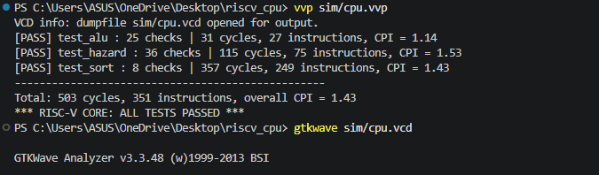
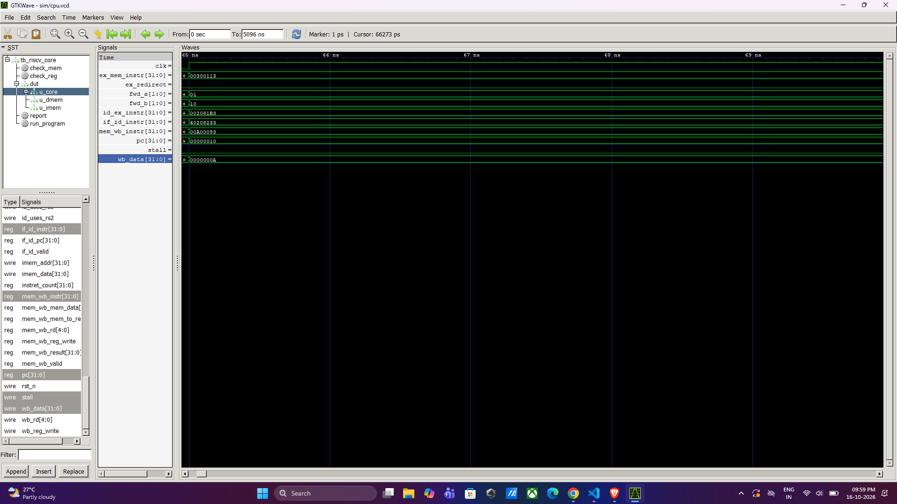
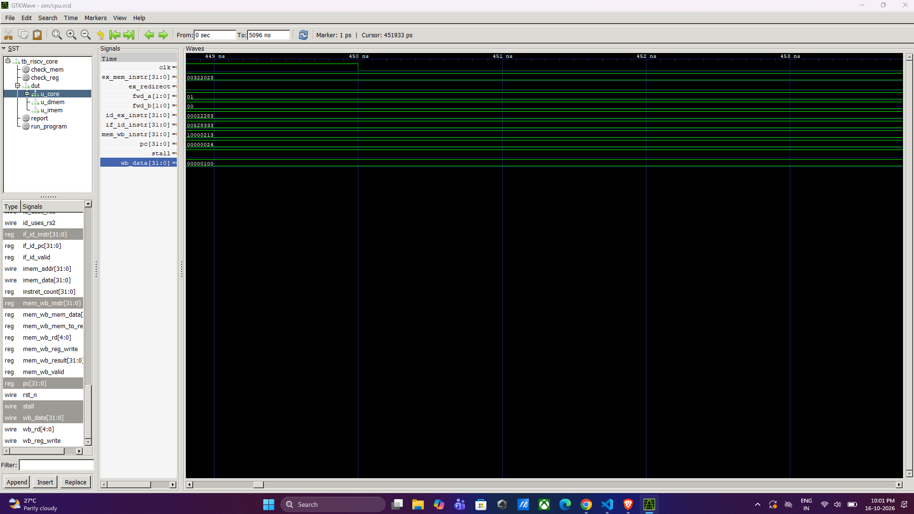

# 5-Stage Pipelined RISC-V (RV32I) CPU Core in Verilog

A 32-bit RISC-V processor core written in Verilog. It runs real RISC-V machine code through a classic **5-stage pipeline** (fetch, decode, execute, memory, write-back) and handles the three kinds of pipeline hazards in hardware: **data forwarding**, **load-use stalls**, and **branch flushing**. The design is verified by a self-checking testbench that runs three RISC-V programs (including a bubble sort) and compares every result against hand-computed values.

## Highlights

- Implements 37 of the 40 RV32I base instructions (`FENCE`, `ECALL` and `EBREAK` are decoded as NOPs)
- 5-stage pipeline: IF, ID, EX, MEM, WB
- Data forwarding from EX/MEM and MEM/WB into the ALU inputs
- Load-use hazard detection with a 1-cycle stall
- Branches and jumps resolved in EX, predict-not-taken, with 2-instruction flush on a taken branch
- Byte, halfword and word loads and stores with sign/zero extension
- Built-in cycle and instruction counters for CPI measurement
- Tested with real machine code assembled with the GNU RISC-V assembler
- Result: **all tests pass, 0 errors, overall CPI = 1.43**

## Pipeline overview

```
        +------+   +------+   +------+   +------+   +------+
  PC -> |  IF  |-->|  ID  |-->|  EX  |-->| MEM  |-->|  WB  |--> register file
        +------+   +------+   +------+   +------+   +------+
        fetch      decode     ALU,       load /     write
        instr.     + read     branch     store      result
                   registers  decision
                         ^        |  ^        |
                         |        |  |        |
                         |        v  |        v
                     [ hazard   [ forwarding ]  (EX/MEM and MEM/WB results
                       unit ]     unit          are fed back to the ALU inputs)
```

Between every pair of stages sits a pipeline register (`IF/ID`, `ID/EX`, `EX/MEM`, `MEM/WB`) that holds the instruction's data and control signals. While one instruction is in EX, the next is in ID and the one after it is in IF, so one instruction can finish every clock cycle.

## How hazards are handled

Overlapping instructions causes three problems. Each has its own fix:

| Hazard | Example | Hardware fix | Cost |
|---|---|---|---|
| **Data hazard**: an instruction needs a result that is not written back yet | `addi x1,x0,1` then `add x2,x1,x1` | **Forwarding**: the result is copied from EX/MEM or MEM/WB straight into the ALU input (`forwarding_unit.v`) | 0 cycles |
| **Load-use hazard**: an instruction needs data that is still being loaded | `lw x5,0(x4)` then `add x6,x5,x5` | **Stall**: PC and IF/ID are frozen for 1 cycle and a bubble (NOP) enters EX; then the value is forwarded (`hazard_unit.v`) | 1 cycle |
| **Control hazard**: the CPU fetched the wrong instructions after a taken branch or jump | `beq` taken | **Flush**: the 2 wrongly fetched instructions are turned into NOPs and the PC jumps to the target | 2 cycles per taken branch |

The register file also uses **write-through**: if write-back and decode touch the same register in the same cycle, the new value is passed directly, which covers the third data-hazard distance without extra forwarding paths.

## Supported instructions

| Group | Instructions |
|---|---|
| Upper immediate / jumps | `LUI`, `AUIPC`, `JAL`, `JALR` |
| Branches | `BEQ`, `BNE`, `BLT`, `BGE`, `BLTU`, `BGEU` |
| Loads | `LB`, `LH`, `LW`, `LBU`, `LHU` |
| Stores | `SB`, `SH`, `SW` |
| Register-immediate | `ADDI`, `SLTI`, `SLTIU`, `XORI`, `ORI`, `ANDI`, `SLLI`, `SRLI`, `SRAI` |
| Register-register | `ADD`, `SUB`, `SLL`, `SLT`, `SLTU`, `XOR`, `SRL`, `SRA`, `OR`, `AND` |

## Project structure

```
riscv_cpu/
├── rtl/
│   ├── alu.v                # 10-operation 32-bit ALU
│   ├── regfile.v            # 32 x 32-bit registers, write-through, x0 = 0
│   ├── imm_gen.v            # I / S / B / U / J immediate decoding
│   ├── control_unit.v       # opcode -> control signals
│   ├── forwarding_unit.v    # data forwarding select logic
│   ├── hazard_unit.v        # load-use stall detection
│   ├── imem.v               # instruction memory (4 KB)
│   ├── dmem.v               # data memory (4 KB, byte/half/word access)
│   ├── riscv_core.v         # the 5-stage pipeline
│   └── riscv_top.v          # core + instruction memory + data memory
├── tb/
│   └── tb_riscv_core.v      # self-checking testbench
├── tests/
│   ├── test_alu.hex         # RISC-V machine code (assembly in comments)
│   ├── test_hazard.hex
│   └── test_sort.hex
├── docs/                    # waveform screenshots and test output
├── sim/                     # generated simulation files (git-ignored)
├── .gitignore
└── README.md
```

## Module summary

| Module | Description |
|---|---|
| `riscv_core` | Pipeline registers, stage logic, branch resolution, performance counters |
| `control_unit` | Decodes the opcode into register-write, memory, ALU-select, branch and jump signals, plus flags saying whether `rs1` / `rs2` are really used (avoids false stalls) |
| `alu` | ADD, SUB, SLL, SLT, SLTU, XOR, SRL, SRA, OR, AND |
| `regfile` | Two read ports, one write port, write-through bypass, `x0` hard-wired to zero |
| `forwarding_unit` | Chooses between register-file data, EX/MEM result and MEM/WB result for each ALU operand (EX/MEM has priority) |
| `hazard_unit` | Detects a load followed by an instruction that needs its result |
| `dmem` | Word-organised memory with byte-lane writes and sign/zero-extended reads |

## Verification

The testbench (`tb/tb_riscv_core.v`) is **self-checking**. For each program it clears the memories and registers, loads a `.hex` file into instruction memory, resets the CPU, and runs until the final `j done` instruction retires. It then compares registers and data memory against expected values worked out by hand, and reports cycles, retired instructions and CPI.

The `.hex` files contain real machine code assembled with the GNU RISC-V assembler (`-march=rv32i`). The assembly source is kept next to each instruction as a comment.

| Program | What it exercises | Checks |
|---|---|---|
| `test_alu` | All arithmetic, logic, shift and compare instructions, LUI/AUIPC, writes to `x0`; many back-to-back dependencies to exercise forwarding | 25 |
| `test_hazard` | Forwarding chains, load-use stalls, load-to-store dependency, `LB/LBU/LH/LHU/SB/SH`, all six branches taken and not taken, wrong-path flush, a loop (sum of 1 to 10), `JAL` / `JALR` function call and return | 36 |
| `test_sort` | A bubble sort of 8 numbers in data memory (nested loops, loads, stores, branches) | 8 |

### Test result



| Program | Cycles | Instructions retired | CPI |
|---|---|---|---|
| `test_alu` | 31 | 27 | 1.14 |
| `test_hazard` | 115 | 75 | 1.53 |
| `test_sort` | 357 | 249 | 1.43 |
| **Total** | **503** | **351** | **1.43** |

An ideal pipeline reaches CPI = 1.0. The measured CPI is higher because of the 4-cycle pipeline fill, 1-cycle load-use stalls, and the 2-cycle penalty on every taken branch.

### Does the testbench really catch bugs?

To confirm the checks are meaningful, five deliberate bugs were injected into the design one at a time. Each one was detected:

| Injected bug | Result |
|---|---|
| EX/MEM forwarding removed | 27 errors |
| Load-use stall removed | 11 errors |
| Branch flush removed | 15 errors |
| `SRA` performed as a logical shift | 2 errors |
| `LB` not sign-extended | 1 error |

## Waveform evidence

Signals shown (hierarchy `tb_riscv_core.dut.u_core`): `pc`, `if_id_instr`, `id_ex_instr`, `ex_mem_instr`, `mem_wb_instr`, `fwd_a`, `fwd_b`, `stall`, `ex_redirect`, `wb_data`. Each `*_instr` signal shows the machine code of the instruction currently in that stage, so you can watch every instruction move one stage per clock.

### 1. Data forwarding



`add x3,x1,x2` (`002081b3`) is in EX. Its source `x1` is produced by `addi x1,x0,10` (`00a00093`), which is now in write-back, so `fwd_a = 01` (take from MEM/WB). Its source `x2` is produced by `addi x2,x0,3` (`00300113`) in the MEM stage, so `fwd_b = 10` (take from EX/MEM). Neither value had reached the register file yet, and the ALU still gets the right operands.

### 2. Jump and pipeline flush


The final `j done` (`0000006f`) is in EX. The instruction fetched behind it is replaced by a NOP (`00000013` in `if_id_instr`), so the wrong-path instruction can never take effect. Write-back at the same moment shows `wb_data = 0x1060`, the `auipc` result that `test_alu` checks.

### 3. Load-use hazard



`lw x5,0(x4)` (`00022283`) is in EX while the instruction that needs `x5`, `add x6,x5,x5` (`00528333`), waits in ID and the PC is held at `0x24`. The load result is only available after the MEM stage, so the pipeline inserts a one-cycle bubble and then forwards the data.

### 4. Branch resolution


`beq x17,x18,skip1` (`01288663`) is in EX. Its operands come through forwarding (`fwd_a = 01`, `fwd_b = 10`), so the comparison uses the newest values of `x17` and `x18`. Behind it, the wrong-path instruction `addi x19,x0,99` (`06300993`) is already in ID. Because the branch is taken, that instruction and the one after it are flushed, which is why `test_hazard` expects `x19 = 0`.

## How to run

Requirements: [Icarus Verilog](https://bleyer.org/icarus/) and GTKWave. The code is plain Verilog (`-g2005`). Run every command from the project root, because the testbench loads the hex files with relative paths.

```powershell
mkdir sim
```

Compile (all files listed explicitly so it works in PowerShell, bash and cmd):

```powershell
iverilog -g2005 -Wall -o sim/cpu.vvp rtl/alu.v rtl/regfile.v rtl/imm_gen.v rtl/control_unit.v rtl/forwarding_unit.v rtl/hazard_unit.v rtl/imem.v rtl/dmem.v rtl/riscv_core.v rtl/riscv_top.v tb/tb_riscv_core.v
```

Simulate:

```powershell
vvp sim/cpu.vvp
```

A successful run ends with `*** RISC-V CORE: ALL TESTS PASSED ***`. Any mismatch prints a `[FAIL]` line with the register or memory address, the value received and the value expected.

View waveforms:

```powershell
gtkwave sim/cpu.vcd
```

## Running your own program

Assemble a program with a RISC-V toolchain (`-march=rv32i -mabi=ilp32`), write one 32-bit hex word per line into a `.hex` file, and load it into instruction memory with `$readmemh`. A program must end with the instruction `j done` (`0000006f`), which is how the testbench detects completion.

## Design decisions and limitations

- **Predict-not-taken.** Branches are resolved in EX, so every taken branch costs 2 cycles. A branch predictor would reduce this.
- **Harvard architecture.** Instructions and data are in separate memories, each 4 KB, starting at address 0.
- **Memories are simulation models** with asynchronous read. On an FPGA they would map to synchronous block RAM, which needs an extra pipeline adjustment.
- **Aligned accesses only.** Misaligned loads and stores are not handled.
- **Not implemented:** `FENCE`, `ECALL`, `EBREAK` (treated as NOPs), CSRs, interrupts and exceptions, multiply/divide, compressed instructions.
- The `*_instr` and `*_valid` pipeline registers are debug and measurement aids; they carry no CPU function.

## Possible extensions

- Branch prediction (static backward-taken, or a small dynamic predictor)
- Resolving branches in ID to cut the branch penalty to 1 cycle
- MEM-to-MEM forwarding to remove the load-to-store stall
- M extension (multiply/divide)
- Synchronous memories and an FPGA implementation
- CSR and trap support, then running the official `riscv-tests` suite

## Tools

Icarus Verilog, GTKWave, Visual Studio Code